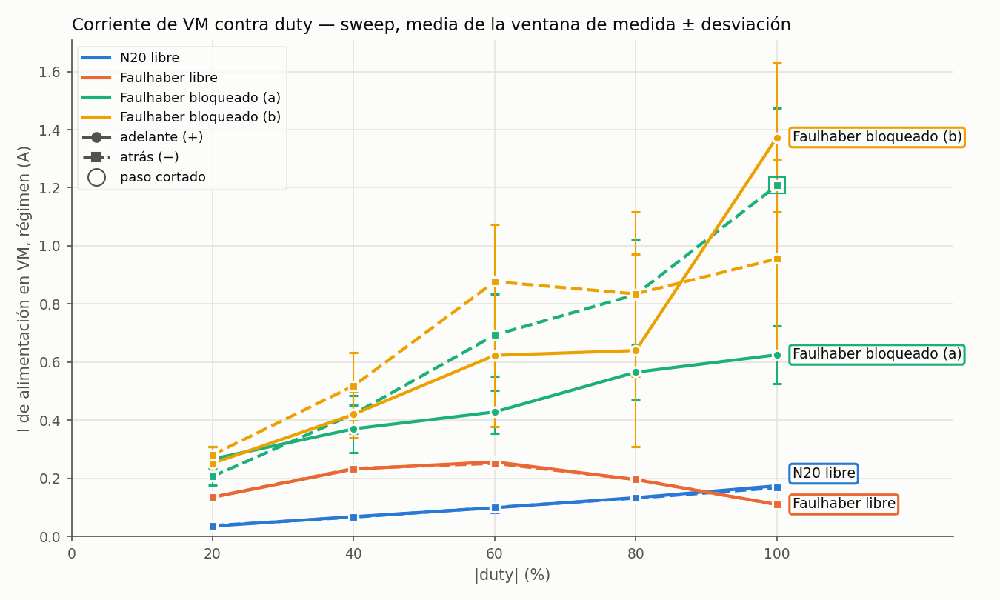
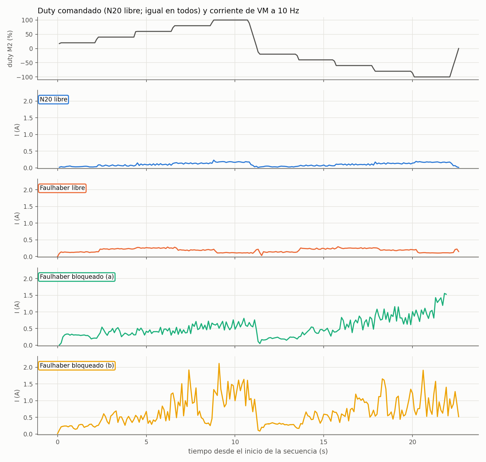

# 11 — Ensayo de motores: N20 y Faulhaber a 12 V

**Fecha:** 20 de noviembre de 2026
**Objetivo:** primer uso del banco ([10](10_banco_motores.md)) con motores reales: documentar las curvas de corriente contra duty de un N20 y de un Faulhaber, libres y bloqueados, y probar los dos canales a la vez.

**Datos:** [`ensayos_motores/2026-11-20/`](ensayos_motores/2026-11-20/) (CSV, capturas del panel, gráficas y tabla completa).

## Resumen

| # | Resultado |
|---|---|
| R1 | ✅ El banco funcionó con carga real: 4 barridos completos o casi completos en M2, el STOP enclavó el HALT y no hubo reinicios durante las secuencias |
| R2 | ✅ **N20 libre:** I_alim proporcional al duty, I_motor ≈ **0.17 A** constante y asimetría adelante/atrás ≤ 4 %. Comportamiento de manual. También valida la cadena de medida del ACS725 |
| R3 | 🟠 **Faulhaber libre:** la curva no es monótona. Sube hasta **0.257 A a 60 %** y baja a **0.110 A a 100 %**. A duty parcial el motor consume más que a plena tensión. Hipótesis: rotor sin hierro de baja inductancia + PWM de 20 kHz con freno (decay lento) forzado por PMODE = GND. Se confirma repitiendo a 50 kHz |
| R4 | 🟡 **Faulhaber bloqueado:** hasta **1.37 A** sostenidos a 100 % y picos de 10 ms de **2.28 A**, pero con mucha dispersión y diferencias entre ensayos y sentidos. El bloqueo no parece haber sido rígido. El ensayo (a) se cortó a mitad de −100 % |
| R5 | ✅ **Dos canales al 100 % (manual):** pico de **4.246 A** en VM (media de 10 ms) sin HALT por `ilim`, detenido con STOP |
| R6 | ✅ La **placa de potencia** alimentó VM a 12 V durante el ensayo, con su entrada barrida en vivo de 8 a 24 V |
| — | 🟡 P3/P4 de [07](07_revision_potencia.md) siguen abiertos: sin falla eléctrica a esas corrientes, pero **no se midió temperatura** y los escalones duraron ≤ 2 s |

## Montaje

| Ítem | Valor |
|---|---|
| Placa de control | Rev A con `orca_motor_bench` (arranque #687 en la captura del N20) |
| Lógica | Por USB. J19 sin alimentar: Vbus (INA226) = 0.00 V en todos los registros |
| VM (J20) | **12 V desde la placa de potencia LM5175**. Su entrada se barrió en vivo de 8 a 24 V durante el ensayo. VM no se mide en la placa de control: 12 V es la consigna |
| Canal | **M2 (U6 → J4)** en los cuatro barridos. M1 solo en la prueba manual de dos canales |
| Ajustes | Rampa 200 %/s, `ilim` 2.0 A (media de 100 ms), PWM 20 kHz, cero del ACS725 320 mV |
| Secuencia | `sweep` M2, 20 → 100 % en pasos de 20 %, adelante y atrás, asentar 1 s + medir 1 s (~23 s por ensayo) |
| Motor 1 | **N20** con reductora. *Pendiente: modelo, tensión nominal y relación* |
| Motor 2 | **Faulhaber**, referencia indicada por el equipo como «M124». *Pendiente: referencia exacta, tensión nominal, resistencia e inductancia en bornes, corriente en vacío* |
| Bloqueo | *Pendiente: cómo se bloqueó el eje (a mano, con mordaza…)* |

## Archivos

| Archivo en el repo | Descargado como | Ensayo | Filas |
|---|---|---|---|
| [`datos/N20_libre_sweep_M2.csv`](ensayos_motores/2026-11-20/datos/N20_libre_sweep_M2.csv) | `orca_motor_log_N20.csv` | N20 sin carga | 221 |
| [`datos/FM_libre_sweep_M2.csv`](ensayos_motores/2026-11-20/datos/FM_libre_sweep_M2.csv) | `orca_motor_log_FM.csv` | Faulhaber sin carga | 220 |
| [`datos/FM_bloqueado_sweep_M2_a.csv`](ensayos_motores/2026-11-20/datos/FM_bloqueado_sweep_M2_a.csv) | `orca_motor_log_FM_Stallcsv` | Faulhaber bloqueado, 1.er intento (cortado) | 214 |
| [`datos/FM_bloqueado_sweep_M2_b.csv`](ensayos_motores/2026-11-20/datos/FM_bloqueado_sweep_M2_b.csv) | `orca_motor_FM_Stall_1.csv` | Faulhaber bloqueado, 2.º intento | 223 |
| [`img/panel_sweep_N20.png`](ensayos_motores/2026-11-20/img/panel_sweep_N20.png) | captura 16:43 | Panel con el informe del barrido del N20 | — |
| [`img/panel_pico_dos_canales.png`](ensayos_motores/2026-11-20/img/panel_pico_dos_canales.png) | `max_I_Orca.png` | Panel tras la prueba manual de dos canales | — |
| [`graficas/`](ensayos_motores/2026-11-20/graficas/) | — | Curvas, series de tiempo y [`resumen.md`](ensayos_motores/2026-11-20/graficas/resumen.md) (tabla por paso) | — |

El orden (a) → (b) sale de la hora de descarga (16:54 y 16:58).

Columnas del CSV: `t_s` (desde el inicio de la secuencia), `step` y `label` (paso), `duty1`/`duty2` (%), `isens_a` (media de 100 ms), `isens_max_a`/`isens_min_a` (máximo y mínimo de medias de 10 ms desde el último reinicio de picos; la secuencia los reinicia al empezar cada ventana de medida), `vbus_v`.

## Resultados





Corriente de alimentación en VM en régimen: media del último segundo de cada paso, en A. La tabla con desviación, picos e I_motor estimada está en [`graficas/resumen.md`](ensayos_motores/2026-11-20/graficas/resumen.md).

| duty | N20 + | N20 − | FM libre + | FM libre − | FM bloq. (a) + | FM bloq. (a) − | FM bloq. (b) + | FM bloq. (b) − |
|---|---|---|---|---|---|---|---|---|
| 20 % | 0.035 | 0.037 | 0.135 | 0.135 | 0.266 | 0.206 | 0.251 | 0.281 |
| 40 % | 0.068 | 0.066 | 0.231 | 0.234 | 0.370 | 0.421 | 0.420 | 0.518 |
| 60 % | 0.098 | 0.100 | **0.257** | 0.251 | 0.428 | 0.693 | 0.623 | 0.877 |
| 80 % | 0.133 | 0.132 | 0.195 | 0.196 | 0.565 | 0.832 | 0.640 | 0.835 |
| 100 % | 0.174 | 0.167 | **0.110** | 0.109 | 0.625 | 1.208 ⚠️ | **1.373** | 0.955 |

⚠️ Paso cortado: la secuencia terminó antes del final de esa ventana (ver R4).

## Análisis

### R2 — N20 libre: referencia limpia

- I_alim crece en línea recta con el duty (0.035 → 0.174 A). I_alim / duty da **I_motor ≈ 0.164–0.184 A en todos los pasos**. Así se comporta un motor en vacío cuya corriente la fija el rozamiento, con corriente continua dentro del ciclo de PWM (L/R grande frente a los 50 µs del período).
- Adelante y atrás coinciden: asimetría máx. 4 % (el panel dio 2 PASS, 0 WARN).
- **Esto también valida la medida.** El ACS725 lee puntos sueltos del PWM y el firmware reparte la fase con un retardo aleatorio. Si la fase se enganchara, I_alim / duty no saldría constante.
- La tabla del panel ([captura](ensayos_motores/2026-11-20/img/panel_sweep_N20.png)) y la calculada desde el CSV con `plot_runs.py` coinciden con ±0.001 A.

### R3 — Faulhaber libre: más consumo a duty parcial

- En vacío, a 100 % (sin conmutación), el Faulhaber toma **0.110 A**: esa es su corriente en vacío real a 12 V.
- A duty parcial toma **más**: 0.135 A a 20 %, 0.231 A a 40 % y un máximo de **0.257 A a 60 %**. Los dos sentidos coinciden con ±0.006 A, así que es repetible y no es ruido. La desviación dentro de cada ventana es baja (≤ 0.013 A).
- Un motor en vacío con corriente continua daría lo del N20: I_alim ∝ duty. Aquí, a 20 % la estimación I_alim / duty da 0.67 A, 6 veces la corriente en vacío. **La estimación de I_motor no sirve para este motor.**

**Hipótesis.** Los micromotores DC de Faulhaber tienen rotor sin hierro (bobinado autoportante), con inductancia en bornes mucho menor que un motor con núcleo como el N20. En el DRV8874 con PMODE = GND (modo PH/EN, fijo en la Rev A), el tiempo apagado del PWM siempre es **freno por los low-side** (decay lento). Con L/R corta frente a los 50 µs del período:

1. En el tiempo encendido la corriente sube casi hasta (V − E)/R.
2. En el tiempo apagado el puente cortocircuita el motor: la fuerza contraelectromotriz invierte la corriente y **frena** en cada ciclo.
3. Para mantener la velocidad, el motor toma más corriente en el tiempo encendido.

El resultado es corriente de rizado que se disipa como I²R en el bobinado, sin trabajo útil. A 100 % no hay conmutación y el efecto desaparece. A 20 % hay poca tensión media y poca fuerza contraelectromotriz, así que el efecto también es menor. Por eso el máximo queda en un duty intermedio.

**Consecuencias:**
- Calentamiento extra del motor a velocidad parcial: un rotor sin hierro tolera poco la temperatura.
- Más corriente en VM y en las pistas.
- Peor eficiencia, justo en el rango de uso normal de un robot.

**Cómo confirmarla** (el banco ya lo permite):
1. Repetir el barrido libre con `freq 50000`: si es rizado, el pico de 60 % debe bajar mucho. Opcionalmente también con `freq 10000`: debe subir.
2. Medir la inductancia en bornes (LCR) o tomarla del datasheet de la referencia exacta.

**Opciones si se confirma:**
- PWM más alto (el banco llega a 50 kHz; el DRV8874 admite 100 kHz).
- Bobina en serie con el motor.
- **Rev B:** dejar PMODE configurable (resistencia opcional o GPIO) para poder usar el modo PWM con decay rápido o libre.

### R4 — Faulhaber bloqueado

| Observación | Valor |
|---|---|
| Corriente sostenida a 100 % | (a) 0.625 A adelante / 1.208 A atrás (cortado); (b) **1.373 A** adelante / 0.955 A atrás |
| Dispersión dentro de la ventana de 1 s | ±0.03 a ±0.34 A (contra ≤ ±0.017 A en los ensayos libres) |
| Picos de 10 ms | Hasta **2.135 A** (a) y **2.280 A** (b) |
| Serie de tiempo | (a) sube lentamente dentro de cada paso (de 1.0 a 1.55 A en −100 %); (b) salta entre 0.5 y 2.1 A |

Un eje bloqueado rígidamente no tiene fuerza contraelectromotriz. La corriente sería estable y proporcional al duty, igual en los dos sentidos y entre ensayos. Lo medido es inestable, diferente por sentido y diferente entre (a) y (b). Eso apunta a un **bloqueo no rígido**: el eje patina o se frena a mano, y la fuerza contraelectromotriz parcial cambia la corriente.

La curva de bloqueo, por lo tanto, **no es un dato del motor** sino de cómo se frenó. Lo que sí deja:
- La corriente de bloqueo real a 12 V es **≥ 1.37 A**, así que la resistencia total (bobinado + 2 × Rds(on) + cables) es **≤ ~8.8 Ω**. Comparar con la resistencia en bornes del datasheet.
- Si el bobinado midiera < ~3.9 Ω, un bloqueo real a 12 V superaría el ITRIP (3.06 A) y el DRV8874 lo regularía por chopping.
- Con `ilim` en 2.0 A sobre 100 ms, un bloqueo rígido a 100 % puede o no disparar el HALT según la resistencia. Ajustar `ilim` al ensayo.

**Ensayo (a) cortado:** el CSV termina a los 21.9 s con el duty todavía en −100 % y sin las filas de bajada. La secuencia se abortó, pero el CSV no guarda la causa. La línea `[FAIL] abortada: …` está en el informe (`/seq.txt`), que no se descargó. Lo más probable es un HALT por `ilim`: la corriente venía subiendo (1.55 A en la última fila, pico de 10 ms de 2.14 A) y la media de 100 ms que dispara no siempre queda registrada, porque el log toma una muestra cada 100 ms. También pudo ser un STOP. *A confirmar con el equipo.*

### R5 — Dos canales al 100 % desde los deslizadores

Prueba manual, sin CSV. De la [captura](ensayos_motores/2026-11-20/img/panel_pico_dos_canales.png):

- **Pico de 4.246 A** en VM (máximo de medias de 10 ms) y mínimo −0.034 A.
- El HALT dice **«STOP desde el panel»**. El firmware conserva la primera causa de HALT, así que **`ilim` no disparó antes del STOP**: la media de 100 ms se quedó bajo 2.0 A aunque las medias de 10 ms llegaron a 4.25 A. El pico fue un transitorio corto (arranque o inversión).
- 4.246 A supera el ITRIP de un solo driver (3.06 A), así que los dos canales aportaban a la vez.
- *No quedó registrado:* carga de cada motor y qué botones se usaron (arranque desde 0, inversión ±100…).

Dos observaciones de la captura para revisar:
- Arriba dice **SIN RESPUESTA**: al tomarla, el panel había perdido la conexión con la placa.
- El recuadro de la secuencia dice **«sin secuencia»**: eso solo pasa si la placa arrancó de nuevo después de la última secuencia. Si nadie la reinició a propósito, revisar `brownouts` y `reset_reason` en `/status.json`. Un reinicio por ruido de los motores sería un hallazgo importante, porque la lógica iba por USB y VM por otra fuente.

### R6 — Placa de potencia como fuente de VM

La placa de potencia LM5175 entregó los 12 V de VM mientras su entrada se barría en vivo de 8 a 24 V, según el equipo. La carga en este ensayo fue de hasta ~1.4 A sostenidos (2 s), con picos de 10 ms de 4.25 A. Su registro está en [Hardware-Potencia/physical_debug](../../Hardware-Potencia/physical_debug/README.md). *Pendiente: qué placa (1 o 2) y el registro del barrido de entrada.*

### Pistas de potencia (P3/P4 de 07)

Corrientes de este ensayo por M2 (U6, OUT2 de 0.35 mm, ~1.5 A para ΔT = 20 °C según IPC-2221): hasta 1.37 A sostenidos durante 2 s y picos de 2.3 A. Sin fallas, pero 2 s es poco para calentar una pista y **no se midió temperatura**. P3/P4 siguen abiertos hasta correr `soak` con cámara térmica.

## Pendientes y próximos ensayos

1. **Completar los datos de los motores** (tabla de montaje): referencia exacta del Faulhaber con su R, L e I en vacío; modelo y relación del N20; cómo se bloqueó el eje.
2. **Confirmar R3:** barrido libre del Faulhaber a 50 kHz (y a 10 kHz) con los mismos ajustes; comparar con `plot_runs.py`.
3. **Bloqueo rígido** (mordaza) a duty bajo primero: `step` o `soak` corto, `ilim` ajustado.
4. **En cada ensayo, descargar también el informe** (`/seq.txt`): ahí queda la causa de un aborto.
5. **Térmico P3/P4:** `soak` a 1, 2 y 3 A con cámara térmica, en M1 y M2.
6. **Repetir en M1 (U5):** todos los barridos de hoy fueron en M2.
7. Medir VM con multímetro o desde la placa de potencia durante el ensayo.
8. Aclarar el reinicio de la prueba de dos canales (R5).

Mejoras posibles del firmware, a partir de lo anterior:
- Escribir en la cabecera del CSV los ajustes de la secuencia y la causa del HALT, para que cada CSV sea autocontenido.
- Guardar el historial de ensayos en la flash con el nombre del motor.

## Regenerar las gráficas

```bash
cd Hardware/physical_debug/ensayos_motores/2026-11-20
python3 ../../orca_motor_bench/plot_runs.py \
  "N20 libre=datos/N20_libre_sweep_M2.csv" "Faulhaber libre=datos/FM_libre_sweep_M2.csv" \
  "Faulhaber bloqueado (a)=datos/FM_bloqueado_sweep_M2_a.csv" \
  "Faulhaber bloqueado (b)=datos/FM_bloqueado_sweep_M2_b.csv" --out graficas
```

`plot_runs.py` acepta cualquier CSV del panel. El orden de los argumentos fija los colores. `--window` debe coincidir con "medir" de la secuencia.
