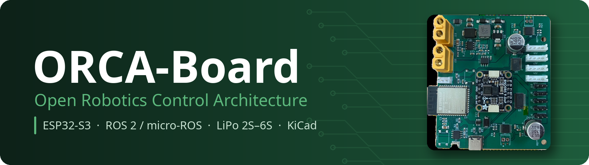
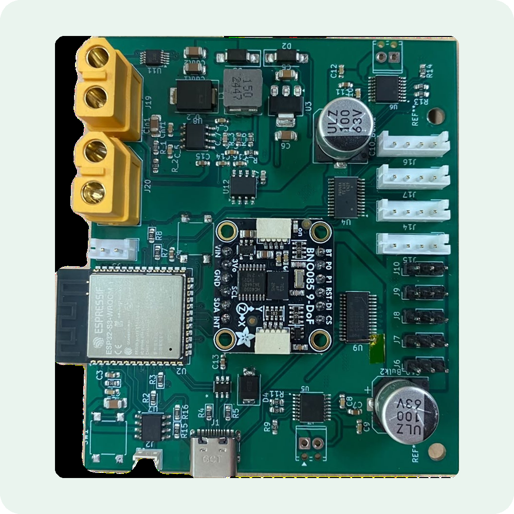
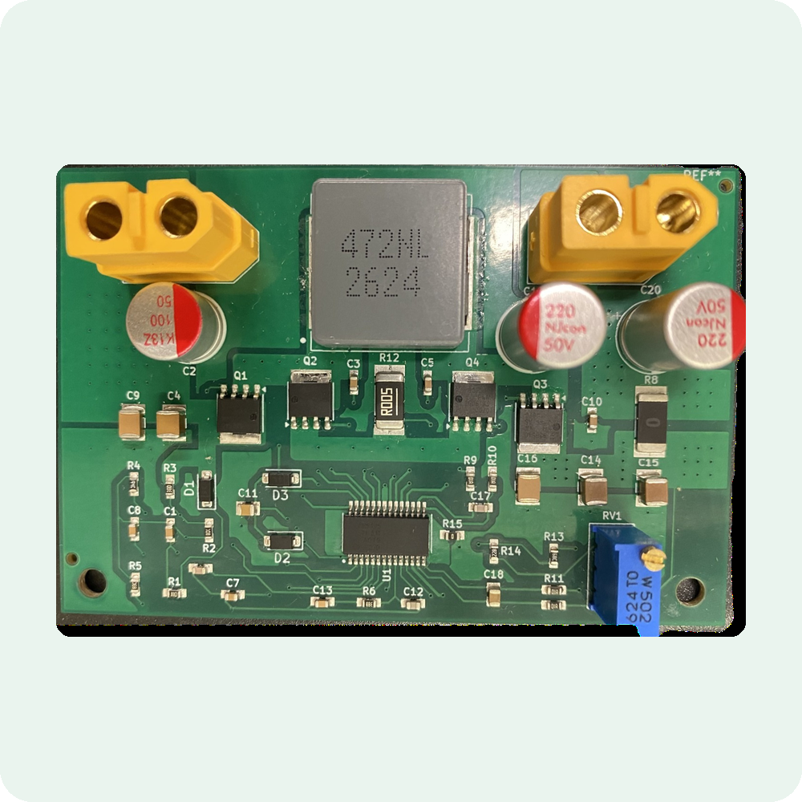
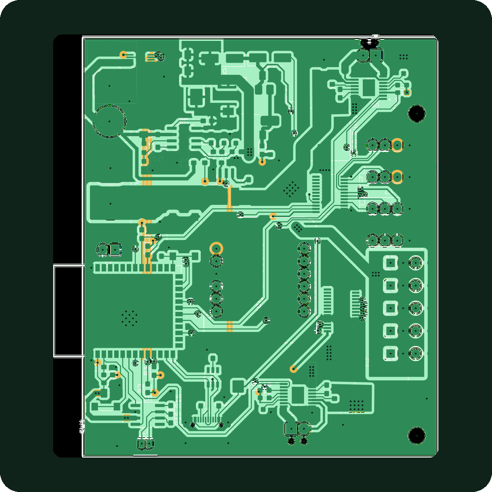
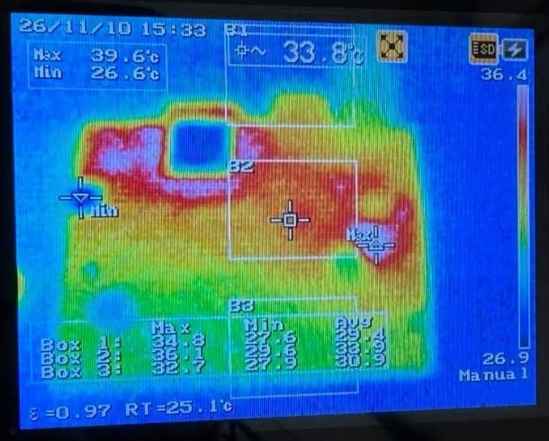
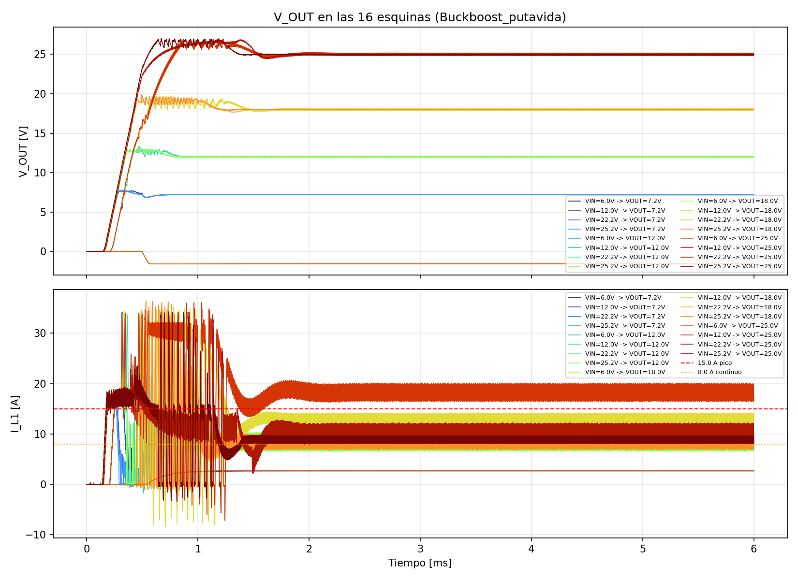
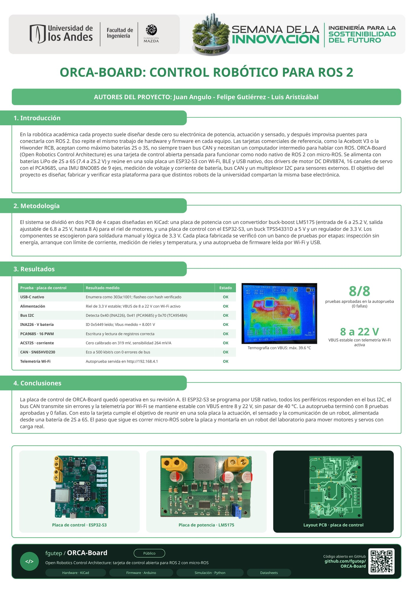

<div align="center">



<br>

**Tarjeta de control abierta para robots con ROS 2, pensada para ser la base electrónica compartida de los robots de la universidad.**

<br>


[](LICENSE)

[Resumen](#resumen) · [Características](#características) · [Estado](#estado-del-proyecto) · [Inicio rápido](#inicio-rápido) · [Estructura](#estructura-del-repositorio) · [Simulación](#simulación-de-la-etapa-de-potencia) · [Equipo](#equipo) · [Licencia](#licencia)

</div>

---

## Resumen

En la robótica académica cada proyecto suele diseñar desde cero su electrónica de potencia, actuación y sensado, y después improvisa puentes para conectarla con ROS 2. Eso repite el mismo trabajo de hardware y firmware en cada equipo. Las tarjetas comerciales de referencia, como la Acebott V3 o la Hiwonder RCB, aceptan como máximo baterías 2S o 3S, no siempre traen bus CAN y necesitan un computador intermedio para hablar con ROS.

**ORCA-Board** (*Open Robotics Control Architecture*) es una tarjeta de control abierta pensada para funcionar como nodo nativo de ROS 2 con micro-ROS. Se alimenta con baterías LiPo de **2S a 6S (7.4 a 25.2 V)** y reúne en una sola placa lo que un robot móvil o un brazo necesitan para actuar, sentir y comunicarse. El objetivo del proyecto es diseñar, fabricar y verificar esta plataforma para que distintos robots compartan la misma base electrónica.

<table>
  <tr>
    <td align="center" width="33%"><br><sub><b>Placa de control</b> · ESP32-S3</sub></td>
    <td align="center" width="33%"><br><sub><b>Placa de potencia</b> · LM5175</sub></td>
    <td align="center" width="33%"><br><sub><b>Layout PCB</b> · placa de control (KiCad)</sub></td>
  </tr>
</table>

## Características

El sistema se divide en **dos PCB de 4 capas** diseñadas en KiCad.

### Placa de control

| Función | Componente |
|---|---|
| Microcontrolador | ESP32-S3-WROOM-1-N4 (Wi-Fi, BLE y USB nativo; 4 MB de flash, sin PSRAM) |
| Motores DC | 2 × drivers DRV8874 |
| Servos | 16 canales PWM con PCA9685 |
| IMU | BNO085 de 9 ejes |
| Voltaje de batería | INA226 |
| Corriente de batería | ACS725 |
| Bus CAN | Transceptor SN65HVD230 |
| Sensores externos | Multiplexor I²C TCA9548A (4 canales: J14–J17) |
| Alimentación lógica | Buck TPS54331D a 5 V y regulador de 3.3 V |

### Placa de potencia

Convertidor **buck-boost LM5175** para el riel de motores: entrada de 6 a 25.2 V, salida ajustable de 6.8 a 25 V y hasta 8 A.

### Mapa de pines (control Rev A)

| Bus / señal | Pines |
|---|---|
| I²C de placa (INA226 `0x40`, PCA9685 `0x41`, BNO085 `0x4A`/`0x4B`) | SDA `IO18` · SCL `IO17` |
| I²C externo (TCA9548A `0x70`) | SDA `IO39` · SCL `IO38` · RESET `IO40` |
| Sensor de corriente ACS725 | `IO9` |
| CAN (500 kbit/s) | TX `IO6` · RX `IO7` |

## Estado del proyecto

| Parte | Estado |
|---|---|
| **Placa de control, Rev A** | ✅ Fabricada y operativa. Autoprueba: **8 pruebas aprobadas, 0 fallas** |
| Placa de potencia (LM5175) | 🔧 Fabricada, en bring-up ([registro](Hardware-Potencia/physical_debug/README.md)) |
| BNO085 | ⏸️ Aún no montado en la placa fabricada |
| micro-ROS sobre la placa | ⏳ Siguiente paso |

### Resultados de la placa de control

| Prueba | Resultado medido | Estado |
|---|---|:---:|
| USB-C nativo | Enumera como `303a:1001`; flasheo con hash verificado | ✅ |
| Alimentación | Riel de 3.3 V estable; VBUS de 8 a 22 V con Wi-Fi activo | ✅ |
| Bus I²C | Detecta `0x40` (INA226), `0x41` (PCA9685) y `0x70` (TCA9548A) | ✅ |
| INA226 · V batería | ID `0x5449` leído; Vbus medido = 8.001 V | ✅ |
| PCA9685 · 16 PWM | Escritura y lectura de registros correcta | ✅ |
| ACS725 · corriente | Cero calibrado en 319 mV, sensibilidad 264 mV/A | ✅ |
| CAN · SN65HVD230 | Eco a 500 kbit/s con 0 errores de bus | ✅ |
| Telemetría Wi-Fi | Autoprueba servida en `http://192.168.4.1` | ✅ |

<table>
  <tr>
    <td align="center" width="50%"><br><sub><b>Termografía con VBUS</b> · máx. 39.6 °C</sub></td>
    <td align="center" width="25%"><h1>8/8</h1><sub>pruebas aprobadas en la autoprueba (0 fallas)</sub></td>
    <td align="center" width="25%"><h1>8–22 V</h1><sub>VBUS estable con telemetría Wi-Fi activa</sub></td>
  </tr>
</table>

La termografía con VBUS dio un máximo de 39.6 °C. El detalle del bring-up, con errata y retrabajos incluidos, está en [`Hardware/physical_debug`](Hardware/physical_debug/README.md).

## Inicio rápido

### 1. Flashear el firmware de autoprueba

El firmware vive en [`Hardware/physical_debug/`](Hardware/physical_debug/). La imagen más completa es [`orca_selftest`](Hardware/physical_debug/orca_selftest/orca_selftest.ino).

**Arduino IDE** (Herramientas →):

| Opción | Valor |
|---|---|
| Placa | ESP32S3 Dev Module |
| USB Mode | Hardware CDC and JTAG |
| USB CDC On Boot | **Enabled** |
| Flash Mode / Size | QIO 80MHz / 4MB (32Mb) |
| Partition Scheme | Default 4MB with spiffs |

**PlatformIO**: el proyecto de [`platformio_bringup/`](Hardware/physical_debug/platformio_bringup/platformio.ini) ya trae la configuración de la placa.

```bash
cd Hardware/physical_debug/platformio_bringup
pio run -t upload
pio device monitor        # 115200 baudios por el USB nativo
```

### 2. Ver la autoprueba

Cada 5 s la placa corre todas las pruebas y publica el informe por **USB** y por **Wi-Fi**.

1. Conéctate a la red `ORCA-Board` (la clave está en el sketch; cámbiala si vas a usar la placa fuera del laboratorio).
2. Abre **http://192.168.4.1/** para ver el informe en vivo.
3. Opcional: `/status.json` (telemetría y resultados) y `/report.txt` (informe en texto).

### 3. Registrar telemetría desde el PC

```bash
python3 Hardware/physical_debug/wifi_telemetry/orca_monitor.py --csv prueba.csv
```

Solo usa la biblioteca estándar de Python, guarda todo en CSV y avisa si la placa deja de responder o se reinicia.

## Estructura del repositorio

```text
ORCA-Board/
├── Hardware/                  PCB de control (KiCad): esquemáticos, PCB, footprints y gerbers
│   └── physical_debug/        Bring-up de la placa fabricada: documentos 01–09 y firmware de prueba
├── Hardware-Potencia/         PCB de potencia LM5175 (KiCad) y su bring-up
│   ├── Gerbers-Pot/           Archivos de fabricación
│   └── physical_debug/        Protocolo de arranque por etapas y diagnóstico
├── simulacion/                Modelos y simulaciones LTspice del buck-boost
│   ├── scripts/               Análisis y gráficas en Python
│   └── resultados/            Figuras de las corridas
├── Datasheets/                Hojas de datos de los componentes
├── Prints/                    Esquemático y layout de la placa de potencia en PDF/PNG
└── docs/img/                  Imágenes de este README
```

## Simulación de la etapa de potencia

La carpeta [`simulacion/`](simulacion/) contiene el modelo LTspice del LM5175 y el barrido de **16 esquinas** (VIN de 6, 12, 22.2 y 25.2 V por VOUT de 7.2, 12, 18 y 25 V) con escalón de carga, contrastado con los límites de diseño de 8 A continuos y 15 A de pico en el inductor.

<p align="center">
  
</p>

Para regenerar las gráficas:

```bash
pip install PyLTSpice pandas matplotlib numpy
python simulacion/scripts/analizar_c1_16esquinas.py ruta/al/archivo.raw
```

## Documentación

| Qué | Dónde |
|---|---|
| Bring-up de la placa de control | [`Hardware/physical_debug/README.md`](Hardware/physical_debug/README.md) |
| Bring-up de la placa de potencia | [`Hardware-Potencia/physical_debug/README.md`](Hardware-Potencia/physical_debug/README.md) |
| Hojas de datos | [`Datasheets/`](Datasheets/) |
| Esquemático y layout de potencia | [`Prints/`](Prints/) |

## Próximos pasos

- [ ] Montar el BNO085 y poner `BNO085_MOUNTED = true` en la autoprueba.
- [ ] Terminar el bring-up de la placa de potencia.
- [ ] Correr micro-ROS sobre la placa.
- [ ] Montarla en un robot del laboratorio para mover motores y servos con carga real.

## Equipo

Proyecto de la Facultad de Ingeniería de la Universidad de los Andes, presentado en la Semana de la Innovación.

| Autor |
|---|
| Juan Angulo |
| Felipe Gutiérrez |
| Luis Aristizábal |

<details>
<summary><b>Ver el póster de la Semana de la Innovación</b></summary>
<br>
<p align="center">
  
</p>
</details>

## Licencia

Este proyecto se distribuye bajo la [licencia MIT](LICENSE).
