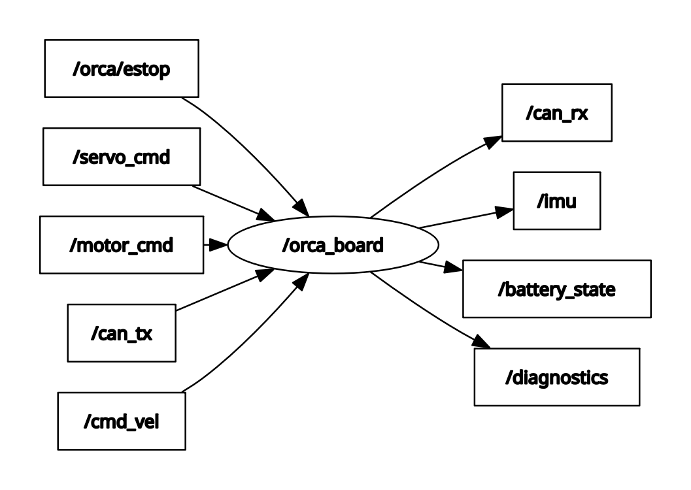
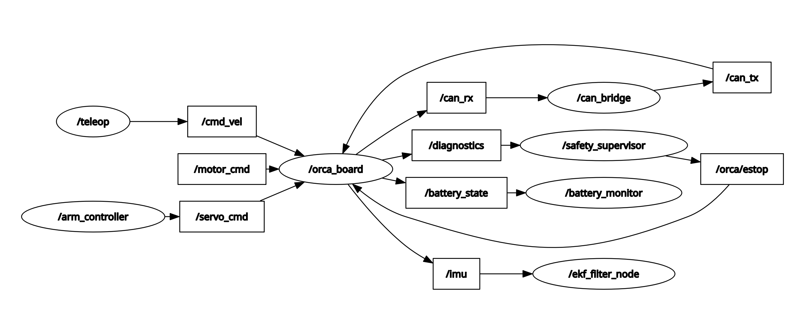
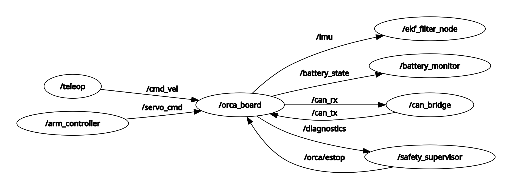

# orca_micro_ros — firmware micro-ROS de la placa de control

Firmware de uso general para la placa de control ORCA Rev A (ESP32-S3-WROOM-1-N4). Convierte la placa en un nodo ROS 2 Jazzy, `/orca_board`, que publica batería, IMU y diagnóstico, recibe comandos de motores y servos, hace de puente con el bus CAN (J2, 25 kbit/s) y expone su configuración como **parámetros ROS 2 que se guardan en la flash**. Implementa el grafo objetivo de la presentación (`06_grafo_ros2`).

> **Versión 1.1.0, probada el 26-nov-2026** en la placa Rev A (MAC 80:45:6b:52:f6:2c), alimentada solo por USB, con J20 sin alimentar. Se verificaron la sesión con el agente, todos los tópicos, los parámetros (cambio, rechazo, persistencia tras un reinicio, `dump` y `load`), el cambio de frecuencia del IMU en caliente, `motor_cmd` y `cmd_vel` → duty, `max_duty`, el deadman, el paso a libre, el HALT por `estop`, la reconexión del agente sin reiniciar la placa y CAN en autoprueba (tramas estándar y extendidas de `/can_tx` de vuelta en `/can_rx` a través del transceptor, con los mismos bytes) y en modo normal sin otro nodo (error passive, como corresponde).
> **Sin probar:** motores y servos moviéndose de verdad (falta VBUS), CAN contra otro nodo real y el transporte Wi-Fi (compila, pero no se ha conectado a un agente).

## Contenido

1. [Arquitectura](#arquitectura)
2. [Inicio rápido](#inicio-rápido)
3. [Interfaz ROS 2](#interfaz-ros-2) (incluye el [grafo en rqt_graph](#grafo-en-rqt_graph))
4. [Parámetros](#parámetros)
5. [Seguridad](#seguridad)
6. [Transportes: USB y Wi-Fi](#transportes-usb-y-wi-fi)
7. [Compilar y flashear](#compilar-y-flashear)
8. [Configuración de micro-ROS](#configuración-de-micro-ros)
9. [Integración con otros paquetes](#integración-con-otros-paquetes)
10. [Solución de problemas](#solución-de-problemas)
11. [Limitaciones y pendientes](#limitaciones-y-pendientes)
12. [Archivos](#archivos)

## Arquitectura

```text
 PC (ROS 2 Jazzy)                                   Placa ORCA (ESP32-S3)
┌──────────────────────────────┐                 ┌───────────────────────────────────────────┐
│ ros2 CLI · rqt · teleop ·    │  DDS (Fast DDS) │ nodo /orca_board (rclc)                   │
│ robot_localization · nav2 …  │◄──────────────► │  ├─ executor: estop, cmd_vel, motor_cmd,  │
│                              │                 │  │   servo_cmd, can_tx, timers, parámetros│
│ micro_ros_agent (Docker)     │  XRCE-DDS por   │  ├─ loop(): control de motores cada 5 ms, │
│  --net=host --ipc=host       │◄──────────────► │  │   BNO085, cola CAN, ping al agente     │
└──────────────────────────────┘  USB-CDC o UDP  │  └─ tarea ACS725 (núcleo 1): corriente y  │
                                                 │      sobrecorriente a 4 kmuestras/s       │
                                                 └───────────────────────────────────────────┘
```

- El ESP32 no habla DDS. Habla **XRCE-DDS** con `micro_ros_agent`, y el agente crea en su nombre las entidades DDS que ven los demás nodos. Sin agente no hay ROS.
- Un solo hilo (`loop()`) maneja micro-ROS, el control de motores y el I2C. Solo la medida de corriente corre aparte, para que la sobrecorriente actúe aunque `loop()` esté ocupado.
- La placa detecta el agente con un ping cada 500 ms. Al encontrarlo crea las entidades y sincroniza la hora; si el ping falla, las destruye y vuelve a esperar. El agente se puede reiniciar sin reiniciar la placa.

## Inicio rápido

```bash
cd firmware/orca_micro_ros

# 1. Compilar y flashear (terminal SIN ROS sourceado, ver "Compilar y flashear")
env -i HOME=$HOME PATH=$HOME/.platformio/penv/bin:/usr/bin:/bin pio run -t upload
#    Si después de flashear la placa no conecta, está en "waiting for download":
~/.platformio/penv/bin/python ~/.platformio/packages/tool-esptoolpy/esptool.py \
  --port /dev/ttyACM0 --before no_reset --after watchdog_reset chip_id

# 2. Agente (otra terminal; Ctrl-C para cerrarlo)
./agent.sh

# 3. Desde cualquier terminal con ROS 2 Jazzy
source /opt/ros/jazzy/setup.bash
ros2 topic echo /diagnostics          # estado legible de la placa
ros2 topic hz /imu
ros2 param list /orca_board
ros2 topic pub -r 10 /motor_cmd std_msgs/msg/Float32MultiArray "{data: [20, 20]}"   # Ctrl-C: se detiene en 0.5 s
```

**Requisito en el PC para CAN:** el tipo `can_msgs/Frame` (`sudo apt install ros-jazzy-can-msgs`). Sin él todo lo demás funciona, pero `ros2 topic echo/pub` sobre `/can_rx` y `/can_tx` falla con *"The message type 'can_msgs/msg/Frame' is invalid"*. La placa no lo necesita: su copia está en `extra_packages/can_msgs`, idéntica a la versión 2.0.0 de Jazzy.

## Interfaz ROS 2

Todos los nombres son relativos: con `ORCA_NAMESPACE="robot1"` quedan como `/robot1/imu`, `/robot1/orca_board`, etc.

### Tópicos

| Tópico | Tipo | Dir. | QoS | Frecuencia | Contenido |
|---|---|---|---|---|---|
| `/battery_state` | `sensor_msgs/BatteryState` | pub | reliable | 2 Hz | VBUS y corriente de motores |
| `/imu` | `sensor_msgs/Imu` | pub | **best effort** | `imu.rate_hz` (50) | Orientación, velocidad angular, aceleración |
| `/diagnostics` | `diagnostic_msgs/DiagnosticArray` | pub | reliable | 1 Hz | 6 estados: power, motors, servos, imu, system, can |
| `/parameter_events` | `rcl_interfaces/ParameterEvent` | pub | reliable | al cambiar | Lo publica el parameter server |
| `/cmd_vel` | `geometry_msgs/Twist` | sub | reliable | ≥ 5 Hz | Tracción diferencial en lazo abierto |
| `/motor_cmd` | `std_msgs/Float32MultiArray` | sub | reliable | ≥ 5 Hz | Duty directo de M1 y M2 |
| `/servo_cmd` | `std_msgs/Float32MultiArray` | sub | reliable | libre | Ángulo de cada canal del PCA9685 |
| `/orca/estop` | `std_msgs/Bool` | sub | reliable | libre | Parada enclavada |
| `/can_rx` | `can_msgs/Frame` | pub | reliable | según el bus | Tramas recibidas por J2 |
| `/can_tx` | `can_msgs/Frame` | sub | reliable | libre | Tramas a transmitir por J2 |

Un suscriptor *reliable* no recibe de un publicador *best effort*. Para `/imu` hay que suscribirse con QoS best effort o "sensor data" (`ros2 topic echo` y `ros2 topic hz` lo negocian solos).

### `/battery_state`

| Campo | Valor |
|---|---|
| `voltage` | VBUS medido por el INA226 (0x40), V. Con solo USB da 0 |
| `current` | −I(VM) del ACS725 (IO9), A, media de 100 ms. **Solo la corriente de los motores**, no la de toda la placa. Negativo = descarga (convención de `BatteryState`) |
| `present` | `true` si el INA226 responde y VBUS > 5 V |
| `percentage`, `charge`, `capacity`, `temperature` | NaN (no se miden) |
| `location` | `"J20"` (conector de batería) |
| `header.frame_id` | `base_link` |

### `/imu`

BNO085 en el I2C de placa (IO18/IO17, 0x4A), sin INT ni RST: se sondea y se reinicia por software. Reportes SH-2:

| Campo | Reporte | Notas |
|---|---|---|
| `orientation` | Game Rotation Vector | Fusión acelerómetro + giróscopo, **sin magnetómetro**: el yaw es relativo al arranque y deriva lentamente, pero no se altera con los motores ni con el acero cercano |
| `angular_velocity` | Gyroscope Calibrated | rad/s |
| `linear_acceleration` | Accelerometer | m/s², **con gravedad** (en reposo plano, z ≈ +9.8), como pide REP 145 |
| covarianzas | fijas | diagonal: orientación 0.0012 rad² (~2°), giro 0.0003, aceleración 0.01; valores aproximados de la hoja de datos |
| `header.frame_id` | `imu_link` | Los ejes son los del BNO085 en la placa. Publicar el TF `base_link → imu_link` según como quede montada |

Se publica un mensaje por cada orientación nueva, con la última aceleración y velocidad angular. Si el BNO085 deja de responder 1 s, se reinicializa cada 2 s; `/diagnostics` lo muestra.

### `/diagnostics`

Un `DiagnosticArray` por segundo con seis `DiagnosticStatus`. `hardware_id = orca-revA-<MAC>`. Se ve con `ros2 topic echo /diagnostics` (ver [Integración](#integración-con-otros-paquetes) para las herramientas gráficas).

| Estado | Nivel | Claves |
|---|---|---|
| `orca_board: power` | ERROR: INA226 no responde · WARN: VBUS < `power.vbus_low_v` | `vbus_v`, `i_vm_a`, `i_zero_mv` (cero del ACS725 calibrado al arrancar) |
| `orca_board: motors` | ERROR: HALT (con la causa) | `duty_m1`, `duty_m2`, `target_m1`, `target_m2`, `awake`, `last_source`, `i_limit_a` |
| `orca_board: servos` | ERROR: PCA9685 (0x41) no responde | `active_channels`, `us_per_tick` |
| `orca_board: imu` | ERROR: BNO085 no responde | `rate_hz` (medida), `inits` |
| `orca_board: system` | OK | `uptime_s`, `reset_reason`, `free_heap`, `min_free_heap`, `agent_sessions`, `time_synced`, `build` |
| `orca_board: can` | ERROR: driver sin iniciar o bus-off · WARN: `self_test` activo o error passive (TEC/REC ≥ 128) | `bitrate`, `state`, `rx_frames`, `tx_frames`, `tx_failed`, `rx_lost`, `tec_rec`, `bus_errors` |

`reset_reason`: `POWERON`, `SW`, `PANIC`, `TASK_WDT` (cuelgue del loop), `BROWNOUT`… El reset por USB del core 2.0.14 aparece como `OTHER`. `agent_sessions` cuenta las conexiones con el agente desde el arranque: si sube sin que `uptime_s` vuelva a 0, el enlace se cortó y se recuperó.

### `/cmd_vel`

Solo se usan `linear.x` (m/s) y `angular.z` (rad/s). Sin encoders, en lazo abierto:

```text
v_izq = linear.x − angular.z · drive.wheel_separation / 2
v_der = linear.x + angular.z · drive.wheel_separation / 2
duty  = v / drive.max_wheel_speed · 100 %        (recortado a ±motor.max_duty; |duty| < 1 % → 0)
```

La rueda izquierda va a M1 (J3) si `drive.left_is_m1 = true`. Ejemplo verificado: `linear.x = 0.2`, `angular.z = −1.0` con 0.20 m y 0.5 m/s da 60 % y 20 %.

### `/motor_cmd`

`data = [M1, M2]` en % de duty, de −100 a 100 (positivo = adelante según `motor.invert_*`). Ignora `drive.*`. Es la entrada para un nodo o controlador del PC que haga su propia cinemática. Con menos de dos elementos se ignora. `/cmd_vel` y `/motor_cmd` escriben las mismas consignas: manda el último mensaje recibido.

### `/servo_cmd`

`data[i]` = ángulo en grados del canal `i` del PCA9685 (0 a 15). 0–180° se convierte en `servo.us_min`–`servo.us_max` a 50 Hz. Valores mayores que 180 se recortan; **NaN o negativo** = sin torque (FULL_OFF). El arreglo puede ser más corto que 16: los canales que no aparecen no cambian. Conectores: J6 = canal 0, J7 = 1, J8 = 2, J9 = 3 (ver `examples/README.md`). Los servos se alimentan de 5V_SERVOS, que sale de VBUS: **con solo USB no se mueven**.

```bash
ros2 topic pub -t 3 /servo_cmd std_msgs/msg/Float32MultiArray "{data: [90, 90, 180, 90]}"
ros2 topic pub -t 3 /servo_cmd std_msgs/msg/Float32MultiArray "{data: [.nan, .nan, .nan, .nan]}"   # sin torque
```

### `/orca/estop`

`true` → HALT enclavado (ver [Seguridad](#seguridad)). `false` → libera el HALT, sea cual sea su causa. Publicar con `-t 3` o más: con `--once` el mensaje puede perderse antes de que el publicador descubra a la placa.

### `/can_rx` y `/can_tx` (bus CAN)

Controlador TWAI del ESP32-S3 (TX = IO6, RX = IO7) con el transceptor U7 SN65HVD230 hacia J2 (CANH = J2.1, CANL = J2.2). **25 kbit/s por defecto** (`can.bitrate`), filtro abierto: se reciben todas las tramas del bus.

`can_msgs/Frame` es el tipo estándar de ROS 2 para CAN (el mismo de `ros2_socketcan`):

| Campo | `/can_rx` (bus → ROS) | `/can_tx` (ROS → bus) |
|---|---|---|
| `id` | Identificador de 11 o 29 bits | Se recorta a 11 bits (0x7FF) o a 29 bits (0x1FFFFFFF) según `is_extended` |
| `is_extended` | Trama extendida (29 bits) | Ídem |
| `is_rtr` | Remote request | Ídem |
| `is_error` | Siempre `false`: el TWAI no entrega tramas de error; los errores del bus van en `/diagnostics` | Se ignora |
| `dlc`, `data[8]` | Longitud y datos; los bytes no usados van en 0 | Se recorta a 8 |
| `header` | `stamp` = hora de llegada a la placa; `frame_id = "can"` | Se ignora |

```bash
ros2 topic echo /can_rx
ros2 topic pub -t 1 -w 1 /can_tx can_msgs/msg/Frame "{id: 0x123, dlc: 4, data: [1, 2, 3, 4, 0, 0, 0, 0]}"
ros2 topic pub -t 1 -w 1 /can_tx can_msgs/msg/Frame "{id: 0x18FF50E5, is_extended: true, dlc: 8, data: [222, 173, 190, 239, 1, 2, 3, 4]}"
```

- **Transmisión sin espera:** cada trama de `/can_tx` entra a una cola de 16. Si la cola está llena se descarta y suma `tx_failed`.
- **Hace falta otro nodo en el bus.** En CAN, una trama solo se completa cuando otro nodo la confirma (ACK). Sin otro nodo, el controlador la reintenta sin fin, pasa a *error passive* (TEC = 128, WARN en `/diagnostics`) y la cola termina llenándose. Para probar sin otro nodo, `can.self_test = true`: modo sin ACK, y cada trama enviada vuelve por `/can_rx` a través del transceptor (prueba el ESP32, U7 y el bus hasta J2).
- **Bus-off:** la placa inicia la recuperación sola (cada 1 s como máximo) y vuelve a arrancar el controlador.
- **Recepción sin agente:** las tramas que llegan sin sesión con el agente se descartan y suman `rx_lost`, igual que las que se pierden por cola llena (`rx_missed_count`, `rx_overrun_count`).
- El HALT **no** bloquea el CAN: los nodos del bus pueden necesitar órdenes de parada justamente durante el HALT. Si hay actuadores en el bus, su seguridad la maneja el nodo del PC que publica `/can_tx`.
- **Hardware** (`Hardware/physical_debug/05_revision_CAN_I2C_sensores.md`): R15 = 120 Ω fija, así que la placa va en un extremo del bus. J2 no tiene pin de tierra: los nodos necesitan una referencia común por otro camino (por ejemplo, el negativo de la batería), o el modo común sale del rango del transceptor (−2 a 7 V).
- **Cambio de velocidad en caliente:** `ros2 param set /orca_board can.bitrate 250000` reinstala el driver (se pierde lo que estaba en las colas). Valores admitidos: 25000, 50000, 100000, 125000, 250000, 500000, 800000 y 1000000; cualquier otro se rechaza.

### Grafo en rqt_graph

La placa sola (`Nodes/Topics (all)`, filtro `/orca_board`): las cinco entradas a la izquierda, las cuatro salidas a la derecha (`/parameter_events` y `/rosout` quedan ocultos).



La placa con nodos de ejemplo del PC (`tools/graph_demo.py`): la arquitectura objetivo de la presentación funcionando sobre el firmware real (`Nodes/Topics (active)`). `/motor_cmd` aparece sin publicador porque el ejemplo maneja la base con `/cmd_vel`.



Solo nodos (`Nodes only`), con los tópicos como etiquetas de las aristas:



Las imágenes salen de `tools/rqt_graph_export.py`, que usa el mismo código que el botón *Save as image* de rqt_graph pero sin abrir ventana (Qt offscreen). Así se regeneran (con la placa conectada y el agente corriendo):

```bash
source /opt/ros/jazzy/setup.bash
python3 tools/rqt_graph_export.py docs/img/rqt_graph_orca_board --mode all --ns-filter /orca_board
python3 tools/graph_demo.py &          # nodos de ejemplo: crean pub/sub pero no publican nada
python3 tools/rqt_graph_export.py docs/img/rqt_graph_sistema --mode active
python3 tools/rqt_graph_export.py docs/img/rqt_graph_nodos --mode nodes
kill %1
```

Cada exportación deja `.png` (2.5× la escena), `.svg` y `.dot`. Para verlo en vivo: `ros2 run rqt_graph rqt_graph`.

## Parámetros

Los 20 parámetros se leen y se escriben con las herramientas estándar (`ros2 param`, `rqt_reconfigure`). Cada cambio aceptado:

1. se valida (tipo, rango y coherencia entre parámetros); si no pasa, se rechaza y el valor anterior se mantiene;
2. se aplica de inmediato, sin reiniciar nada;
3. se guarda en la NVS de la placa (espacio `orca_ros`), **así que sobrevive a reinicios y a cortes de alimentación**. Al arrancar, la placa carga de la NVS y usa el valor de fábrica para lo que falte o esté fuera de rango.

| Parámetro | Tipo | Fábrica | Rango | Efecto al cambiarlo |
|---|---|---|---|---|
| `motor.i_limit_a` | double | 2.0 | 0.1–3.0 A | Umbral de sobrecorriente (media de 100 ms de I(VM)). Las pistas VM/OUT2 de U5/U6 aguantan ~1.5–1.8 A con ΔT = 20 °C (doc 07) |
| `motor.ramp_rate` | double | 200.0 | 0–10000 %/s | Velocidad de cambio del duty; 0 = escalón |
| `motor.max_duty` | double | 100.0 | 0–100 % | Recorte del duty en ambos motores, para `cmd_vel` y `motor_cmd` |
| `motor.cmd_timeout_ms` | int | 500 | 50–5000 ms | Deadman |
| `motor.idle_coast_ms` | int | 1000 | 0–60000 ms | Tiempo en freno (duty 0) antes de dormir los drivers |
| `motor.pwm_hz` | int | 20000 | 1000–75000 Hz | Frecuencia del PWM; se aplica en el acto |
| `motor.invert_m1` | bool | false | | Invierte la polaridad de M1. **Libera ambos motores al cambiar** |
| `motor.invert_m2` | bool | false | | Ídem para M2 |
| `drive.wheel_separation` | double | 0.20 | 0.01–5.0 m | `cmd_vel`: distancia entre los puntos de contacto de las ruedas |
| `drive.max_wheel_speed` | double | 0.50 | 0.01–20.0 m/s | `cmd_vel`: velocidad de rueda a 100 % de duty (medirla en el robot) |
| `drive.left_is_m1` | bool | true | | `cmd_vel`: rueda izquierda en M1. Libera ambos motores al cambiar |
| `servo.us_min` | int | 500 | 200–3000 µs | Pulso a 0°. Debe quedar ≥ 100 µs por debajo de `us_max`. Reaplica los servos activos |
| `servo.us_max` | int | 2400 | 200–3000 µs | Pulso a 180° |
| `servo.pca_osc_hz` | int | 25000000 | 20–30 MHz | Calibración del oscilador del PCA9685: medir con osciloscopio un pulso nominal de 1500 µs y poner `osc · medido / 1500` |
| `servo.limp_on_disconnect` | bool | true | | `true`: los servos se sueltan si se pierde el agente. `false`: mantienen la última posición (útil para un brazo que no debe caer) |
| `imu.rate_hz` | int | 50 | 1–200 Hz | Frecuencia de los reportes del BNO085 y de `/imu`; reinicializa el IMU (hueco breve en `/imu`). Probado a 100 Hz |
| `power.vbus_low_v` | double | 6.0 | 0–60 V | Umbral de WARN de VBUS en `/diagnostics` |
| `can.enabled` | bool | true | | Enciende o apaga el controlador CAN |
| `can.bitrate` | int | 25000 | 25k, 50k, 100k, 125k, 250k, 500k, 800k, 1M bit/s | Velocidad del bus; reinstala el driver |
| `can.self_test` | bool | false | | Modo sin ACK con autorrecepción, para probar sin otro nodo (ver [CAN](#can_rx-y-can_tx-bus-can)) |

### Uso

```bash
ros2 param list /orca_board
ros2 param get /orca_board drive.wheel_separation
ros2 param describe /orca_board motor.i_limit_a           # descripción y rango
ros2 param set /orca_board drive.wheel_separation 0.235   # se guarda en la placa
ros2 param dump /orca_board > config/mi_robot.yaml        # respaldo de la configuración actual
ros2 param load /orca_board config/mi_robot.yaml          # aplica (y guarda) un archivo completo
ros2 param load /orca_board config/defaults.yaml          # restaura los valores de fábrica
```

- **Los tipos no se convierten.** `ros2 param set ... drive.wheel_separation 1` falla con `Type mismatch` porque `1` es entero: escribir `1.0`. Al revés, `motor.pwm_hz 20000.0` también falla.
- Las respuestas posibles: `Set parameter successful`, `Rejected by server` (fuera de rango o incoherente) o `Type mismatch`.
- No se pueden crear ni borrar parámetros.
- Flujo recomendado por robot: copiar `config/defaults.yaml` a `config/<robot>.yaml`, ajustarlo, cargarlo una vez y versionarlo. La placa lo recuerda; volver a cargarlo solo hace falta al cambiar de robot o tras borrar la flash.
- `pio run -t upload` no borra la NVS: los parámetros sobreviven al reflasheo. `pio run -t erase` (o `esptool erase_flash`) sí la borra.

## Seguridad

Las reglas son las del banco de motores (`orca_motor_bench`):

| Situación | Reacción |
|---|---|
| Arranque | DRV8874 dormidos (nSLEEP bajo, motores libres) y servos sin torque. Nada se mueve hasta recibir un comando |
| Sin `cmd_vel`/`motor_cmd` durante `motor.cmd_timeout_ms` | Consigna 0 con rampa. Tras `motor.idle_coast_ms` en 0 (en freno), los drivers vuelven a dormir |
| Se pierde el agente (3 pings fallidos) | Motores libres de inmediato. Servos sin torque si `servo.limp_on_disconnect` |
| `/orca/estop true` | **HALT enclavado**: motores libres, servos sin torque, se ignoran `cmd_vel`, `motor_cmd` y `servo_cmd` |
| Sobrecorriente: media de 100 ms de I(VM) > `motor.i_limit_a` | HALT enclavado. La tarea de corriente baja nSLEEP directamente, sin esperar a `loop()` |
| `/orca/estop false` | Libera el HALT. Los motores siguen libres y los servos sin torque hasta el siguiente comando |
| Cambio de `motor.invert_*` o `drive.left_is_m1` | Libera ambos motores (no se invierte el sentido con el motor girando) |
| `loop()` colgado más de 5 s | El watchdog reinicia la placa; arranca segura (primera fila) |

El HALT no sobrevive a un reinicio: después de un reset la placa arranca segura, pero sin HALT. Si el robot exige rearme manual tras cualquier falla, el nodo del PC debe publicar `/orca/estop true` al ver `agent_sessions` o `uptime_s` cambiar.

**Límites de lo que se mide:** nFAULT e IPROPI de los DRV8874 no llegan al ESP32, así que no hay corriente por motor ni aviso de falla del driver. Solo se mide la corriente total de VM. El DRV8874 limita por su cuenta a ~3 A (ITRIP) y reintenta.

## Transportes: USB y Wi-Fi

El transporte se elige al compilar, con el entorno de PlatformIO:

| Entorno | Transporte | Agente | Estado |
|---|---|---|---|
| `orca_usb` (por defecto) | USB-CDC nativo del ESP32-S3 | `./agent.sh` | Probado |
| `orca_wifi` | UDP sobre Wi-Fi (la placa se une a una red como estación) | `./agent.sh udp` | Compila; sin probar contra un agente |

### USB

El puerto USB queda dedicado a XRCE-DDS: no hay consola de texto (el estado está en `/diagnostics`). Mientras el agente tiene el puerto abierto, `pio run -t upload`, `esptool` y `pio device monitor` no pueden usarlo: cerrar el agente antes de flashear.

### Wi-Fi

La red y la IP del PC con el agente se pasan por variables de entorno al compilar y quedan grabadas en el binario:

```bash
env -i HOME=$HOME PATH=$HOME/.platformio/penv/bin:/usr/bin:/bin \
  ORCA_WIFI_SSID="MiRed" ORCA_WIFI_PASS="clave" ORCA_AGENT_IP=192.168.1.50 \
  pio run -e orca_wifi -t upload
./agent.sh udp          # en el PC con esa IP; abrir el puerto UDP 8888 si hay firewall
```

- Sin `ORCA_WIFI_SSID` u `ORCA_AGENT_IP` la compilación falla con un mensaje que lo indica.
- Al arrancar, la placa espera **sin límite** a unirse a la red; los motores ya están seguros en ese momento. Después imprime su IP y el agente por el USB (115200), que en esta variante queda libre.
- El PC y la placa tienen que estar en la misma red y sin aislamiento de clientes (las redes de la universidad suelen aislarlos; usar un router propio o el hotspot del PC).
- El ahorro de energía del Wi-Fi va desactivado para que la latencia sea estable.

### Varias placas y dominios

En `platformio.ini` (`[env]` → `build_flags`):

- `-DORCA_ROS_DOMAIN_ID=0`: tiene que coincidir con `ROS_DOMAIN_ID` de los nodos del PC.
- `-DORCA_NAMESPACE='""'`: con `"robot1"`, todo queda bajo `/robot1/…`. Necesario si hay varias placas en el mismo dominio. Con USB, cada placa necesita su propio agente y su propio puerto (`agent.sh` usa el puerto by-id de esta placa; ajustar `PORT` para otra).

## Compilar y flashear

```bash
cd firmware/orca_micro_ros
env -i HOME=$HOME PATH=$HOME/.platformio/penv/bin:/usr/bin:/bin pio run            # solo compilar (orca_usb)
env -i HOME=$HOME PATH=$HOME/.platformio/penv/bin:/usr/bin:/bin pio run -t upload  # compilar y flashear
```

- **No compilar con ROS sourceado.** La librería micro-ROS se construye con colcon desde fuente, y las variables de `/opt/ros/jazzy/setup.bash` (`AMENT_PREFIX_PATH`, `CMAKE_PREFIX_PATH`…) la rompen. `env -i …` arranca un entorno limpio; también sirve una terminal nueva sin `source`.
- La **primera compilación de cada entorno** descarga y construye micro-ROS Jazzy (~2–3 min, requiere red). Las siguientes tardan ~10 s.
- **Después de flashear**, la placa suele quedar en `waiting for download` (el reset por USB no vuelve a leer los straps) y no conecta con el agente. Se recupera con un reset por watchdog:

  ```bash
  ~/.platformio/penv/bin/python ~/.platformio/packages/tool-esptoolpy/esptool.py \
    --port /dev/ttyACM0 --before no_reset --after watchdog_reset chip_id
  ```

  Si esptool no logra conectar, la placa ya estaba corriendo el firmware: no hace falta nada. Desconectar y reconectar el USB también sirve.
- Si se modifica `colcon.meta`, hay que reconstruir la librería: `rm -rf .pio/libdeps/<entorno>/micro_ros_platformio/libmicroros` y compilar.

Uso de memoria (v1.1.0): `orca_usb` 119 KB de RAM estática (36 %) y 559 KB de flash (43 % de la partición de 1.3 MB), con ~200 KB de heap libre en marcha. `orca_wifi` 145 KB y 972 KB (74 %).

## Configuración de micro-ROS

| Elemento | Valor | Por qué |
|---|---|---|
| Distribución | Jazzy | La del PC (`/opt/ros/jazzy`). Agente y librería deben ser de la misma distribución |
| Librería | `micro_ros_platformio` fijada en el commit `cfee17f` | Compilación reproducible |
| Plataforma | espressif32 6.5.0 (Arduino core 2.0.14, ESP-IDF 4.4) | La misma de los demás firmwares del repo |
| Agente | `microros/micro-ros-agent:jazzy` en Docker | Sin compilar el agente; `--net=host --ipc=host` para que Fast DDS del contenedor y del PC se vean |
| Executor | 13 handles: 5 suscripciones + 2 timers + 6 del parameter server | `estop` va primero para atenderse antes que los comandos del mismo ciclo |

`colcon.meta`, límites de `rmw_microxrcedds` (memoria estática, se fijan al construir la librería):

| Opción | Valor | En uso |
|---|---|---|
| `RMW_UXRCE_MAX_NODES` | 1 | 1 |
| `RMW_UXRCE_MAX_PUBLISHERS` | 6 | 5 (battery, imu, diagnostics, can_rx, parameter_events) |
| `RMW_UXRCE_MAX_SUBSCRIPTIONS` | 6 | 5 |
| `RMW_UXRCE_MAX_SERVICES` | 6 | 6 (parameter server) |
| `RMW_UXRCE_MAX_CLIENTS` | 0 | 0 |
| `RMW_UXRCE_MAX_HISTORY` | 4 | Mensajes en cola por suscripción |
| `RMW_UXRCE_STREAM_HISTORY` | 8 | Búferes de 8 × 512 B por sentido: caben `/diagnostics` (~1.5 KB) y las respuestas del parameter server (`describe` de los 17, `param load` completo), que van fragmentados |
| `RCLC_PARAMETER_MAX_STRING_LENGTH` | 100 | Nombres y descripciones de parámetros (el valor por defecto, 50, corta las descripciones) |

**Mensajes propios:** micro_ros_platformio compila todo paquete que esté en `extra_packages/`. Ahí está `can_msgs` (BSD, copiado de [ros-industrial/ros_canopen](https://github.com/ros-industrial/ros_canopen), rama `dashing-devel`, versión 2.0.0, `Frame.msg` idéntico al del paquete `ros-jazzy-can-msgs`). Agregar otro paquete de mensajes es copiarlo ahí y reconstruir la librería.

Para agregar tópicos o servicios, subir el límite correspondiente, reconstruir la librería y sumar los handles del executor en `createEntities()`.

## Integración con otros paquetes

- **Teleoperación:** `ros2 run teleop_twist_keyboard teleop_twist_keyboard` publica `/cmd_vel` al pulsar teclas. Manteniendo la tecla se repite; al soltarla el robot se detiene en `motor.cmd_timeout_ms`. Ajustar antes `drive.max_wheel_speed` y empezar con `motor.max_duty` bajo.
- **Cinemática en el PC (recomendado para un robot real):** un nodo propio, o `diff_drive_controller` de ros2_control con un hardware interface que publique `/motor_cmd`, mantiene la geometría en un YAML del robot. La placa queda con los límites de seguridad (`motor.*`). Con encoders, la odometría también va en el PC.
- **Fusión:** `robot_localization` (`ekf_node`) acepta `/imu` directamente. Por usar el Game Rotation Vector, configurar el yaw como relativo (o usar solo `angular_velocity.z`) y publicar el TF `base_link → imu_link`.
- **Monitoreo:** `rqt_runtime_monitor` lee `/diagnostics` directamente; `rqt_robot_monitor` lee `/diagnostics_agg`, así que necesita `diagnostic_aggregator` en el PC. Ninguno de los dos está instalado en este PC (`sudo apt install ros-jazzy-rqt-runtime-monitor`).
- **Parámetros en GUI:** `ros2 run rqt_reconfigure rqt_reconfigure` usa los mismos servicios que `ros2 param` (probados); la GUI en sí no se ha probado con la placa.

## Solución de problemas

| Síntoma | Causa y solución |
|---|---|
| El agente arranca pero no aparece `session established` | La placa quedó en `waiting for download` tras flashear: reset por watchdog (ver arriba) o reconectar el USB |
| `ros2 node list` no muestra `/orca_board` pero el agente sí tiene sesión | `ROS_DOMAIN_ID` distinto entre el PC y la placa, o el agente sin `--net=host --ipc=host`. Probar `ros2 daemon stop` y repetir |
| La sesión se abre y se cierra cada 1–2 s | `createEntities()` falla a mitad de camino y vuelve a empezar. En el log del agente (`./agent.sh usb -v6`) se ve qué fue lo último creado antes del `delete_client`. Causa típica: un límite de `colcon.meta` por debajo de las entidades en uso |
| `pio run -t upload` no puede abrir el puerto | El agente lo tiene abierto: `docker stop orca_agent` |
| La compilación de la librería falla con errores de colcon/ament | ROS sourceado en la terminal: usar `env -i …` |
| Un nodo propio no recibe `/imu` | `/imu` es *best effort*: suscribirse con `rclpy.qos.qos_profile_sensor_data` (o `rclcpp::SensorDataQoS()`). Un suscriptor *reliable* no se empareja |
| `Type mismatch` al cambiar un parámetro | Escribir los double con punto decimal (`0.0`, `1.0`) |
| Un comando de 1 mensaje (`--once`) no llega | Descubrimiento DDS: publicar con `-t 3` o `-r 10` |
| `/orca_board` aparece dos veces tras reiniciar el agente | Caché del daemon de ROS 2 con el participante anterior: `ros2 daemon stop` |
| `ros2 topic echo /can_rx` dice que el tipo es inválido | Falta `can_msgs` en el PC: `sudo apt install ros-jazzy-can-msgs` |
| `orca_board: can` en WARN *error passive* | Nadie da ACK: no hay otro nodo, el bitrate no coincide, falta la tierra común o la terminación. Con `can.self_test = true` se prueba la placa sola |
| `orca_board: power` en WARN con solo USB | Normal: no hay VBUS. Motores y servos no tienen alimentación |

## Limitaciones y pendientes

- Probar con VBUS: sentido de giro (`motor.invert_*`), `drive.max_wheel_speed` real, corriente con carga y los servos del brazo.
- Probar el transporte Wi-Fi contra un agente.
- Probar CAN contra otro nodo real a 25 kbit/s (solo se probó en autoprueba y en modo normal sin otro nodo).
- Sin filtro de aceptación configurable: se reciben todas las tramas del bus (a 25 kbit/s son como máximo ~200 tramas/s, sin problema para el enlace).
- Sin encoders no hay lazo cerrado de velocidad ni `/odom`.
- La corriente es solo la total de VM: no hay medida por motor ni nFAULT.
- `/battery_state` no estima la carga (`percentage`): falta la química y el número de celdas de la batería del robot.
- rclc solo admite parámetros bool, int y double: los `frame_id` son fijos (`base_link`, `imu_link`).

## Archivos

| Archivo | Qué es |
|---|---|
| `src/main.cpp` | Todo el firmware: drivers, medidas, parámetros, micro-ROS |
| `platformio.ini` | Entornos `orca_usb` y `orca_wifi`, dominio y namespace |
| `colcon.meta` | Límites de la librería micro-ROS |
| `config/defaults.yaml` | Valores de fábrica de los parámetros (restaurar con `ros2 param load`) |
| `agent.sh` | Lanza `micro_ros_agent` en Docker, por USB o UDP |
| `extra_packages/can_msgs/` | Paquete de mensajes CAN que se compila dentro de la librería micro-ROS |
| `tools/rqt_graph_export.py` | Exporta el grafo como lo dibuja rqt_graph (PNG, SVG, DOT) sin abrir ventana |
| `tools/graph_demo.py` | Nodos de ejemplo del PC alrededor de la placa (no publican nada) |
| `docs/img/` | Imágenes del grafo de este README |
